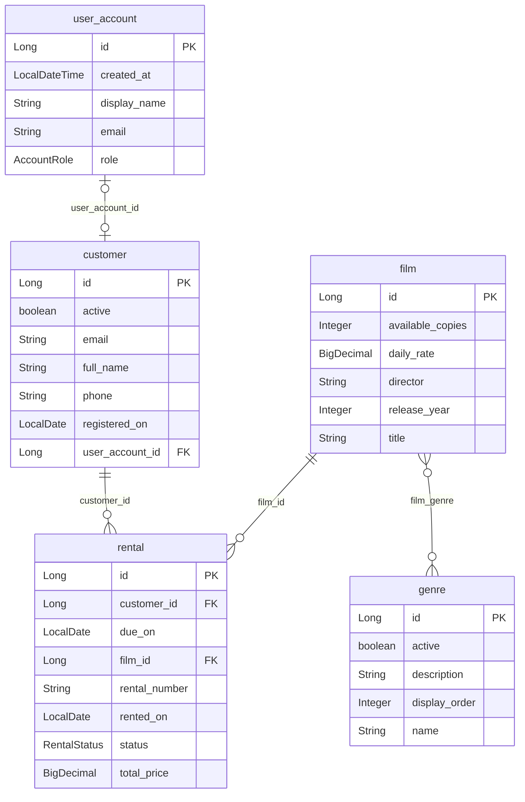

# Schemat bazy danych

Plik generują reguły projektu (panel Maven → Lifecycle → verify). Nie edytujcie go ręcznie.

Tabele: 6 (w tym tabele łączące @ManyToMany: film_genre) · kolumny: 31 · relacje: 2 × @ManyToOne, 1 × @OneToMany, 1 × @OneToOne, 1 × @ManyToMany

| Tabela | Encja | Kolumny | Klucze obce |
|---|---|---|---|
| customer | Customer | 7 | user_account_id |
| film | Film | 6 | — |
| genre | Genre | 5 | — |
| rental | Rental | 8 | customer_id, film_id |
| user_account | UserAccount | 5 | — |

